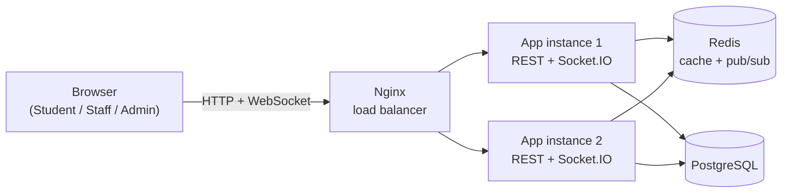

# ClinicSlot: Real-Time Clinic Appointment Booking

A full-stack appointment booking system for a campus clinic. Staff publish time slots, students book them, staff approve and manage the appointments, and everyone sees availability change **live**, with no page refresh.

Built to run like a small production system: a load balancer in front of two app instances, Redis for caching and real-time messaging, and PostgreSQL as the source of truth. The whole stack starts with one command.

## Highlights

- **Real-time updates.** When a slot is booked or released, every open browser updates instantly over WebSockets. Students only receive updates about their own bookings.
- **No double booking.** A database-level rule allows only one active appointment per slot, so two people clicking at the same moment cannot both succeed. The second gets `409 Conflict`.
- **Fast browsing.** The most frequent read, listing slots, is served from a Redis cache and invalidated on every change.
- **Scales horizontally.** Two stateless app instances run behind Nginx. JWT auth and Redis pub/sub mean any instance can serve any user, and live events reach clients on both.
- **Role-based access.** Three roles (student, staff, admin) with permission checks on every route.
- **Clear appointment lifecycle.** `pending` → `confirmed` → `completed` or `cancelled`. Status only moves forward.

## Architecture



| Layer | Technology |
|---|---|
| Load balancer / reverse proxy | Nginx |
| Backend | Node.js, Express |
| Real-time | Socket.IO with the Redis adapter |
| Cache and pub/sub | Redis |
| Database | PostgreSQL |
| Auth | Stateless JWT, bcrypt password hashing |
| Frontend | Vanilla HTML, CSS and JavaScript |
| Infrastructure | Docker Compose |

## Quick start

You only need [Docker Desktop](https://www.docker.com/products/docker-desktop).

```bash
git clone https://github.com/YOUR-USERNAME/YOUR-REPO.git
cd YOUR-REPO
docker compose up --build
```

When you see `[app-1] listening on :3000` and `[app-2] listening on :3000`, open **http://localhost:3000**.

Stop with `Ctrl + C`. Reset all data with `docker compose down -v`.

**Demo accounts**

| Role | Email | Password |
|---|---|---|
| Student | student@cui.edu.pk | Student@123 |
| Staff | staff@cui.edu.pk | Staff@123 |
| Admin | admin@cui.edu.pk | Admin@123 |

**Try it:** open two browser windows, one as a student and one as staff. Book a slot as the student and watch the staff window update instantly. The top-right indicator shows which app instance each window is connected to.

## How it works

### Data model
```
users (1) ──< clinic_slots       staff publish slots
users (1) ──< appointments       students book appointments
clinic_slots (1) ──< appointments
```

A partial unique index on `appointments(slot_id) WHERE status <> 'cancelled'` is what guarantees one active booking per slot, even across multiple app instances.

### Caching
Slot listing uses cache-aside with lazy loading and a 60 second TTL. Every booking, cancellation or slot edit bumps a version number in Redis, which drops all older cached lists at once. If Redis is down, the API falls back to PostgreSQL. Responses carry an `X-Cache: HIT` or `MISS` header.

### Real-time events

| Event | When | Who receives it |
|---|---|---|
| `slot:taken` | A student books a slot | Everyone |
| `slot:released` | An appointment is cancelled | Everyone |
| `slot:changed` | A slot is created, edited or deleted | Everyone |
| `appointment:updated` | Appointment status changes | The owning student, plus staff and admin |

### Access control

| Action | Student | Staff | Admin |
|---|---|---|---|
| View slots | Yes | Yes | Yes |
| Create, edit, delete slots | No | Yes | Yes |
| Book an appointment | Yes | No | No |
| View and cancel own appointments | Yes | n/a | n/a |
| View all appointments | No | Yes | Yes |
| Confirm, complete or cancel any appointment | No | Yes | Yes |
| Manage user roles | No | No | Yes |

## API overview

Base URL `/api/v1`, with `Authorization: Bearer <token>`.

| Method | Endpoint | Access |
|---|---|---|
| POST | `/auth/register`, `/auth/login` | Public |
| GET | `/auth/me` | Any user |
| GET | `/clinic-slots`, `/clinic-slots/:id` | Any user |
| POST, PATCH, DELETE | `/clinic-slots`, `/clinic-slots/:id` | Staff, Admin |
| POST | `/clinic-slots/:id/appointments` | Student |
| GET | `/clinic-slots/:id/appointments` | Staff, Admin |
| GET | `/appointments`, `/appointments/:id` | Any user (students see only their own) |
| PATCH | `/appointments/:id/status` | Student (cancel only), Staff, Admin |
| GET, PATCH | `/users`, `/users/:id/role` | Admin |

Common responses: `400` invalid input, `401` not signed in, `403` role not allowed, `404` not found, `409` slot already taken, `422` invalid status change.

## Project structure

```
.
├── server.js            # API, auth, RBAC, cache, Socket.IO
├── db/schema.sql        # PostgreSQL schema
├── public/index.html    # Frontend
├── docker-compose.yml   # Nginx, 2 app instances, Redis, PostgreSQL
├── nginx.conf           # Load balancer configuration
├── Dockerfile
└── package.json
```

## Possible next steps

- HTTPS termination at Nginx
- Automated API tests
- Email or SMS reminders for confirmed appointments
- Admin analytics for busy hours and no-shows